# 一、Vue核心

## 1.1 Vue简介

### 1.1.1 Vue官网

通过浏览器访问 -> [中文官网](https://cn.vuejs.org/) OR [英文官网](https://vuejs.org/)。


### 1.1.2 **Vue是什么？**

Vue是一套动态构建用户界面的渐进式JavaScript框架。

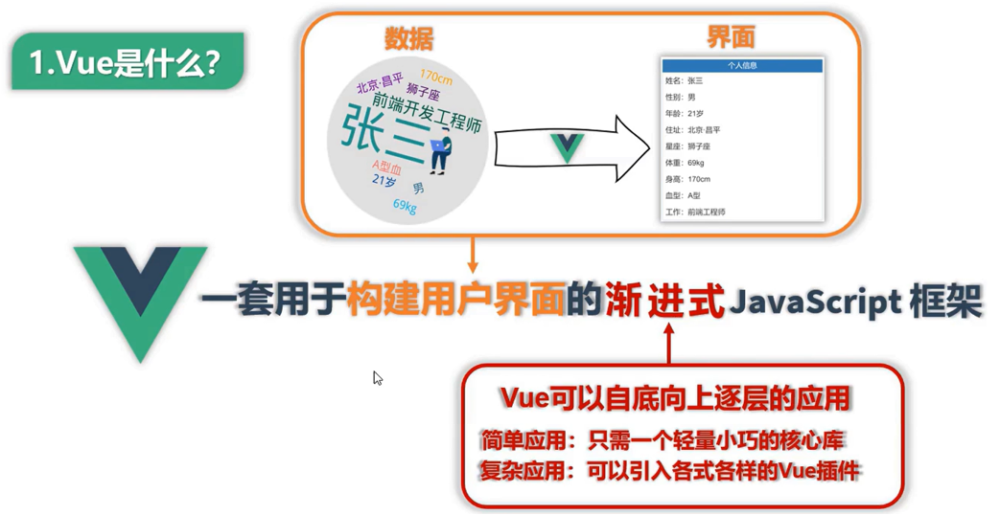

> Vue是尤雨溪在2014年发布的一套轻量级前端框架。


### 1.1.3 Vue的特点

**Vue特点：**

+ 采用组件化模式，提高代码复用率、且让代码更好维护。
+ 声明式编码，让编码人员无需直接操作DOM，提高开发效率。
+ 使用虚拟DOM + 优秀的Diff 算法，尽量复用DOM节点。


**特点演示：**

1. **组件化模式：**

   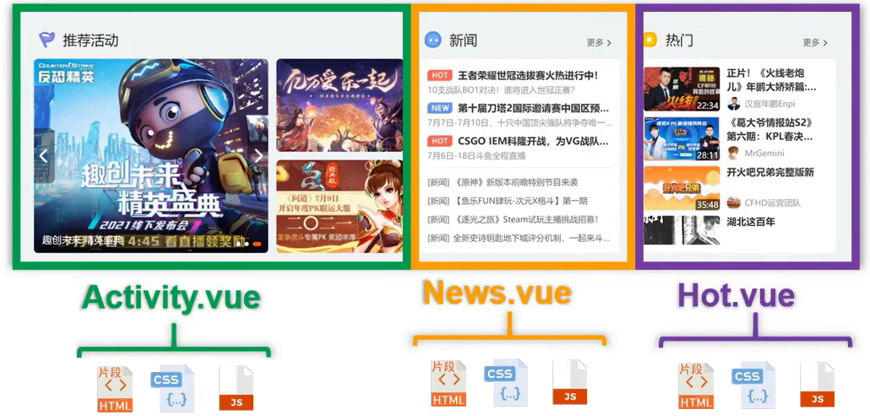

   将复杂页面的每个模块封装成独立的vue文件，提高可复用性及方便维护。

2. **声明式编码：**

   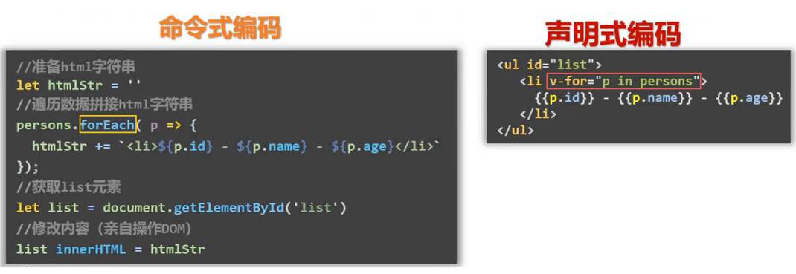

   减少直接使用DOM操作。

3. **使用虚拟DOM + DIFF算法：**

   直接操作真实 DOM 操作是昂贵的，访问和修改都可能触发浏览器的重排和重绘，频繁操作会导致浏览器不断重新计算布局和渲染，增加性能开销。

   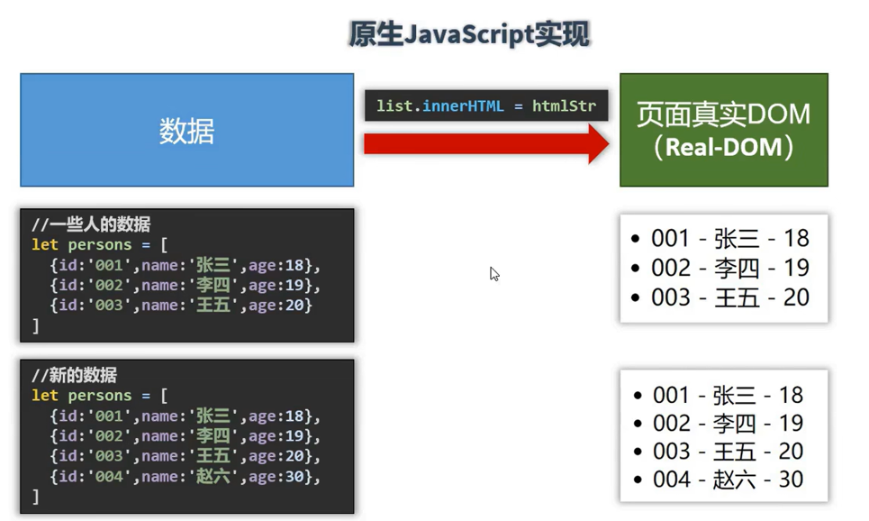

   而vue提供虚拟DOM 和 DIFF算法，在数据更新时vue会先在内存中对比新旧虚拟 DOM，**只把真正变化的部分同步到真实 DOM**，避免了全量更新。

   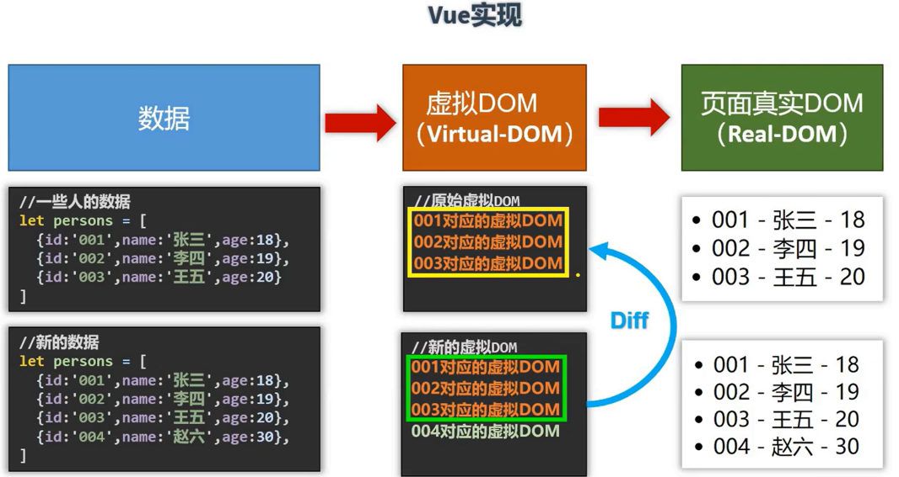


**特点总结：**

+ **组件化**让复杂 UI 可拆解、可复用、易维护；
+ **声明式编码**让开发者只描述结果、不手动操作 DOM，提升开发体验；
+ **虚拟 DOM + Diff** 是支撑声明式的底层机制，它让"描述结果"能高效地映射到真实 DOM，从而兼顾开发体验和运行性能。


### 1.1.4 Vue相关前置知识

前置知识：

> ES6语法规范、ES6模块化、包管理器、原型及原型链、数组常用方法、axios、promise等。


## 1.2 初识Vue

### 1.2.1 创建工程

访问Vue官网，找到导航栏 学习 -> 教程 ，切换到`2.x`版本，找到`直接用<script>引入`侧边栏内容：

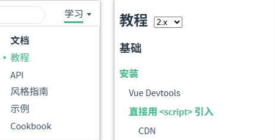


将开发和生产版本的vue.js文件下载下来：

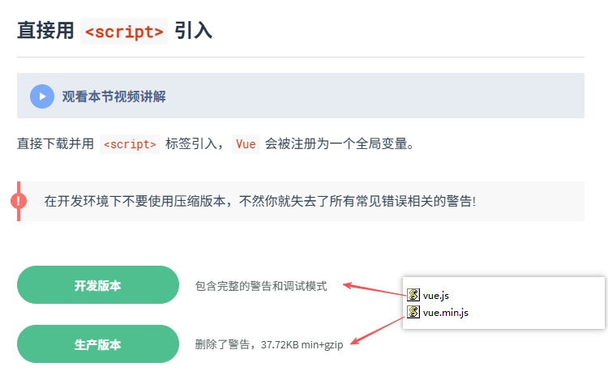


新建文件夹`vue_basic`，把vue文件放进来，并新建第一个html文件：

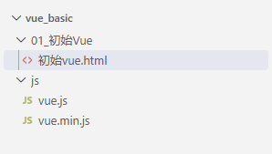

```html
<!DOCTYPE html>
<html lang="en">
<head>
    <meta charset="UTF-8">
    <meta name="viewport" content="width=device-width, initial-scale=1.0">
    <title>初始Vue</title>
    <!-- 引入Vue -->
    <script type="text/javascript" src="../js/vue.js"></script>
</head>
<body>
    
</body>
</html>
```


VS Code右键菜单 -> `Open with Live Server`（需要安装`Live Server`），打开浏览器F12进入控制台，可以看到Vue对象已经被引入了。

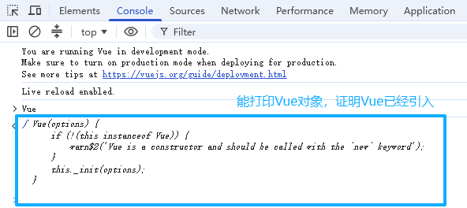


### 1.2.2 关闭开发版本提示

每次打开的时候都会出现开发版本的提示：

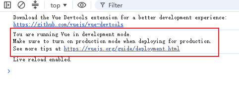

我们可以查看官网API的`全局配置`部分，`Vue.config`包含对Vue的全局配置设置，里面`productionTip`负责生产提示的开启关闭。

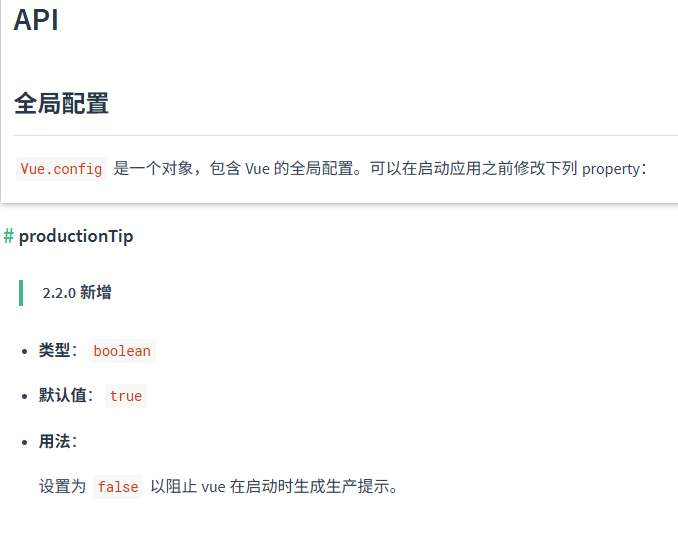

在代码中添加关闭生产提示，并重新启动，生产提示不再出现。

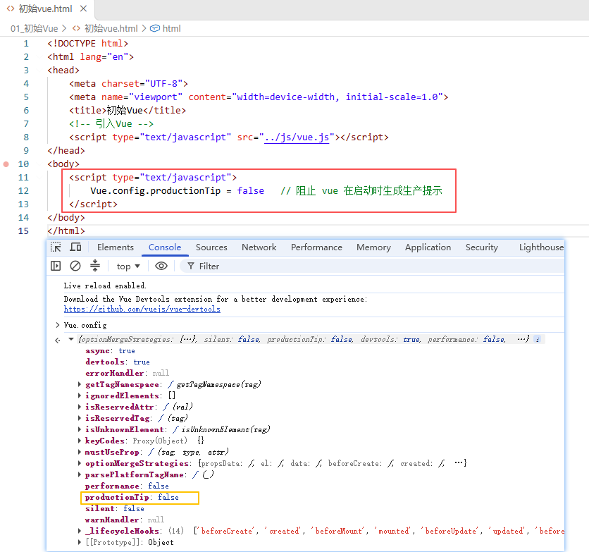


### 1.2.3 安装vue调试工具

可以直接在谷歌扩展应用商城中获取。

最新版本的vue devtools 不支持v2版本的vue，因此需要使用官方停止更新的版本vue devtool 5.x。[v2 devtools](https://chromewebstore.google.com/detail/vuejs-devtools-v5/hkddcnbhifppgmfgflgaelippbigjpjo)


### 1.2.4 使用vue实现一个页面

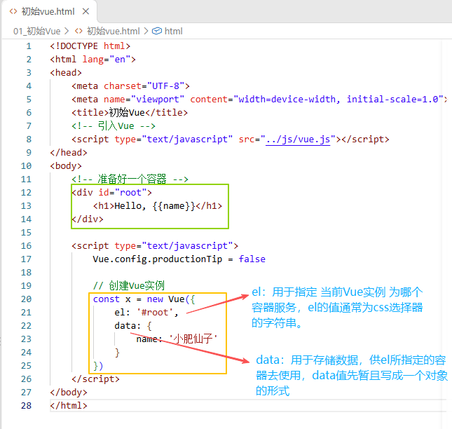

效果如图：

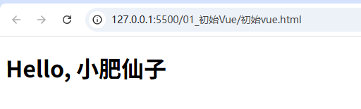


**总结：**

1. 想让Vue工作，就必须创建一个Vue实例，且要传入一个配置对象。
2. root容器里的代码依然符合html规范，只不过混入了一些特殊的Vue语法。
3. root容器里的代码被称为 **Vue模板**。


# 二、Vue组件化编程


# 三、 使用Vue脚手架


# 四、 Vue中的ajax


# 五、vuex


# 六、vue-router


# 七、Vue UI组件库

